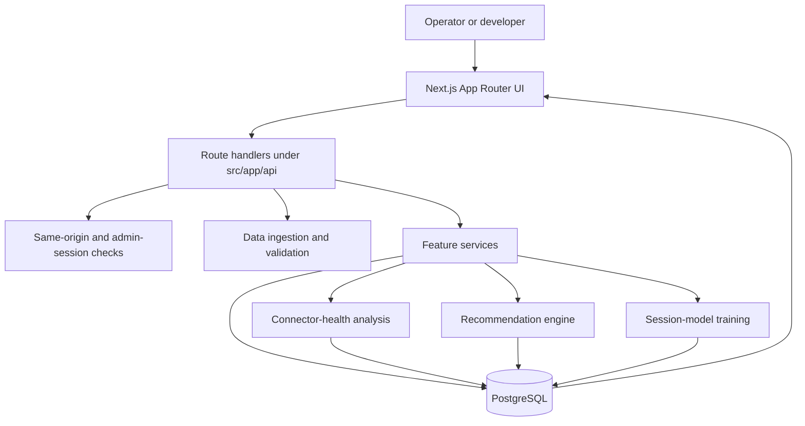
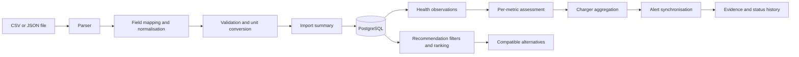
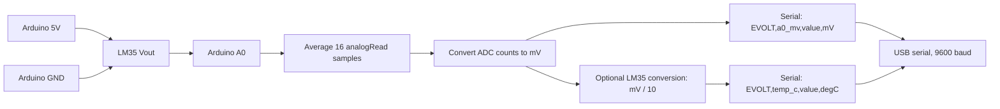

# EVOLT

## An explainable intelligence platform for EV charging-connector health and degradation analysis

EVOLT is a research prototype for analysing charger-health evidence, identifying potentially
concerning patterns, explaining why an alert was raised, and helping users find compatible
alternative chargers.

The project addresses a practical condition-monitoring problem: repeated use of high-current
charging connectors can be associated with mechanical wear, contamination, changing contact
quality, and other factors that may appear in measurements before a charger becomes unavailable.
EVOLT does **not** directly inspect a connector or certify its safety. It analyses the data made
available to it and presents evidence categories that can support inspection and operational
decision-making.

> **Research prototype - not a certified EV safety system.** An EVOLT anomaly is not proof of
> physical connector degradation. Missing data is not treated as healthy, and stale or simulated
> data is labelled accordingly.

The repository contains two complementary but independently operated components:

1. **EVOLT software platform** - a Next.js application for charger-health analysis, explainable
   alerts, station discovery, data ingestion, recommendations, and session-model evaluation.
2. **Arduino Uno bench simulation** - a low-voltage sketch that reads an analogue sensor input
   and emits serial readings for demonstration purposes. It is not connected to live EV charging
   equipment and does not reproduce high-current charging conditions.

The Arduino sketch is independently runnable. The repository also includes an optional
host-side serial collector that can log bench readings and, when explicitly configured, send
them to the supporting-sensor endpoint. That optional path does not turn the bench into a live
charger monitor: sensor readings remain supporting context and never determine charger health.

## Contents

- [Project goals](#project-goals)
- [Implemented capabilities](#implemented-capabilities)
- [Architecture](#architecture)
- [Technology stack](#technology-stack)
- [Health-analysis method](#health-analysis-method)
- [Data model](#data-model)
- [Repository structure](#repository-structure)
- [Prerequisites](#prerequisites)
- [Installation and local development](#installation-and-local-development)
- [Environment variables](#environment-variables)
- [Database migrations and seed data](#database-migrations-and-seed-data)
- [Datasets and import formats](#datasets-and-import-formats)
- [API overview](#api-overview)
- [Software walkthrough](#software-walkthrough)
- [Arduino Uno bench simulation](#arduino-uno-bench-simulation)
- [Testing and evaluation](#testing-and-evaluation)
- [Deployment](#deployment)
- [Research foundation](#research-foundation)
- [Limitations and future work](#limitations-and-future-work)
- [Contribution and licence](#contribution-and-licence)

## Project goals

EVOLT is designed to demonstrate how an operational charger-health workflow can combine:

- canonical data validation and provenance;
- charger-specific baselines rather than only fleet-wide thresholds;
- robust, trend-aware anomaly detection;
- evidence-backed alert explanations;
- health-aware and vehicle-compatible alternative-charger recommendations;
- explicit handling of insufficient, stale, unknown, and simulated data; and
- reproducible local development with migrations and automated tests.

The central contribution is **connector-health intelligence**, not simply an EV charging-station
map. Maps and recommendations are operational surfaces built around the health-analysis workflow.

## Implemented capabilities

### Software platform

- Dashboard with fleet-health distribution, recent alerts, and a station map.
- Station and charger discovery, filtering, and detail views.
- Charger-health status derived from primary metrics and data sufficiency.
- Historical observation charts and evidence summaries.
- Explainable alerts for persistent deviation, sustained adverse trends, and recurring faults.
- CSV and JSON dataset preview, validation, import, deduplication, and row-level issue reporting.
- Registry, observation, and charging-session dataset support.
- Unit conversion into canonical metric units.
- Health-aware alternative-charger ranking with connector and vehicle-power compatibility.
- Analytics pages describing the active analysis version and data-quality constraints.
- Optional labelled-session model training using deterministic cross-validation.
- Local sensor-reading ingestion for supporting context.
- Local editing protection using same-origin checks and optional HMAC-backed admin sessions.
- Security headers configured in `next.config.ts`.

### Bench simulation

- Reads an analogue input on Arduino pin `A0`.
- Averages 16 ADC samples to reduce noise.
- Converts the averaged ADC value to millivolts assuming the default 5 V reference.
- Optionally interprets the millivolt value as an LM35-style temperature reading.
- Emits readings at 9600 baud every five seconds.
- Uses an explicit low-voltage bench-only safety scope.

## Architecture

### Software architecture

EVOLT uses the Next.js App Router. UI routes call route handlers and server-side feature
services. Drizzle ORM provides typed PostgreSQL access, while Zod and feature-specific
normalisation logic validate incoming data before persistence.



The app does not require a remote ML service. The health rules and session-model evaluation run
in-process. Database migrations are forward-only SQL files in `database/migrations`.

### Data and analysis flow



### Independent hardware relationship

```mermaid
flowchart LR
    S[LM35-style analogue sensor, optional] --> A0[Arduino Uno A0]
    A0 --> ADC[16-sample ADC averaging]
    ADC --> SERIAL[USB serial at 9600 baud]
    SERIAL --> MON[Arduino Serial Monitor]
    SERIAL -. optional local logging .-> COL[tools/serial-collector]
    COL -. optional supporting-context upload .-> API[/api/sensor-readings]
    API --> DB[(sensor_readings)]
```

The dashed path is optional and is not a live telemetry, hardware-control, or connector-safety
pipeline. The Arduino does not control EVOLT, and the software does not control the Arduino.
Sensor readings are deliberately excluded from charger-health status and alert generation.

## Technology stack

| Area | Implementation |
| --- | --- |
| Web framework | Next.js `16.4.3`, App Router |
| UI | React `19.3.0`, TypeScript |
| Styling and UI | Tailwind CSS 4 tooling, project components, IBM Plex fonts |
| Database | PostgreSQL |
| ORM and migrations | Drizzle ORM and Drizzle Kit |
| Validation | Zod plus feature-level validation and normalisation |
| Charts | Recharts |
| Maps | Leaflet with configurable tile URL and attribution |
| File ingestion | Papa Parse for CSV plus JSON parsing |
| Unit tests | Vitest |
| API integration tests | Vitest with a test PostgreSQL database |
| Browser tests | Playwright |
| Optional serial tooling | Python 3 with `pyserial` |
| Hardware | Arduino Uno or compatible board, optional LM35-style analogue sensor |

The project requires Node.js `20.9` or newer. The exact dependency versions are recorded in
`package.json` and `package-lock.json`.

## Health-analysis method

### Metrics

EVOLT stores measurements in canonical units and assigns each metric a role:

| Metric | Canonical unit | Role |
| --- | --- | --- |
| `contact_resistance` | mOhm | Primary |
| `voltage_drop` | mV | Primary |
| `fault_count` | count | Primary |
| `power_loss` | kW | Primary |
| `voltage_fluctuation` | % | Supporting only |
| `temperature_rise` | degC | Supporting only |

The primary metrics can contribute to charger health. Voltage fluctuation and temperature rise
are displayed as context but cannot raise a health status or alert on their own.

### Per-metric assessment

The deterministic analysis in `src/features/anomaly-detection/assess-metric.ts`:

1. Rejects non-finite, implausible, duplicate, and excessively future-dated observations.
2. Flags stale or irregularly sampled histories.
3. Establishes a charger-specific baseline from the earliest valid observations using the median
   and robust scale.
4. Checks persistence across the recent observation window.
5. Detects sustained positive trends using a Theil-Sen slope and consistency checks.
6. Evaluates recurring faults over a 30-day window when fault data is available.
7. Produces evidence points, thresholds, explanations, confidence notes, and suggested actions.

The current analysis configuration is centralised in `src/config/analysis.ts` and versioned as
`2026.10-2`. The active defaults include:

| Parameter | Current value |
| --- | ---: |
| Minimum baseline observations | 6 |
| Maximum baseline observations | 12 |
| Minimum recent observations | 3 |
| Persistence window | 5 |
| Minimum persistent deviations | 3 |
| Robust deviation threshold | 3.5 robust z |
| Minimum relative deviation | 8% |
| Trend window | 10 |
| Trend consistency | 75% adverse pairwise slopes |
| Minimum trend change | 15% of baseline median |
| Fault look-back | 30 days |
| Stale-data threshold | 45 days |
| Future timestamp tolerance | 10 minutes |

### Charger-level status

The worst assessable primary metric determines the charger category:

- `normal` - no concerning primary evidence in the available data;
- `monitor` - evidence warrants continued observation;
- `inspection_recommended` - evidence warrants inspection;
- `insufficient_data` - there is not enough valid evidence to assess the charger.

Two independent primary metrics at `monitor` can escalate the charger to
`inspection_recommended`. Missing data is never converted into a healthy result. Historical
results are labelled when the newest observation is older than the stale threshold.

These are evidence categories, not safety certifications. Alternative causes can include sensor
faults, operating conditions, vehicle-side faults, network problems, or data-quality issues.

### Alert synchronisation

The implemented alert rules are:

- `persistent_deviation`;
- `sustained_trend`; and
- `fault_recurrence`.

Repeated findings update an existing unresolved alert instead of creating duplicates. When a
condition disappears, the alert becomes inactive rather than being silently deleted. Alert
status changes are recorded in `alert_events`, with constrained transitions for open,
acknowledged, resolved, and dismissed states.

### Recommendation ranking

The recommendation engine in `src/features/recommendations/engine.ts`:

1. Requires valid coordinates for distance ranking.
2. Excludes offline chargers.
3. Applies connector compatibility, minimum-power, radius, and optional inspection filters.
4. Excludes unknown connector types when compatibility is required.
5. Ranks health before availability and distance:
   `normal`, `insufficient_data`, `monitor`, `inspection_recommended`.
6. Uses 5 km distance bands, usable power capped by vehicle power, and exact straight-line
   Haversine distance.

Driving distance, live network availability, and price are not used because those data sources
are not implemented. Results include reasons, exclusions, and known limitations.

### Optional session models

Imported charging sessions preserve numeric columns and optional labels. Training:

- requires at least 40 labelled rows;
- requires at least two classes and at least five samples per class;
- excludes identifier-like fields ending in `_id` or `_code`;
- compares a majority-class baseline, an explainable threshold model, and multinomial
  logistic regression; and
- uses deterministic stratified five-fold cross-validation with seed `20260425`.

EVOLT stores a model report only when the candidate beats the baseline by the configured
margin. This is in-process statistical evaluation, not a production model-serving system.

## Data model

The Drizzle schema in `src/lib/db/schema.ts` contains:

| Table | Purpose |
| --- | --- |
| `stations` | Station identity, descriptive fields, coordinates, operator, synthetic flag |
| `chargers` | Station relationship, connector, power, operational state, health state, summary JSON |
| `health_observations` | Canonical metric values, provenance, source units, timestamps, import relation |
| `alerts` | Rule, severity, metric, evidence, confidence note, suggested action, analysis version |
| `alert_events` | Alert status history |
| `dataset_imports` | File hash, dataset kind, counts, issues, and affected chargers |
| `vehicle_profiles` | Connector compatibility and maximum DC power |
| `sensor_readings` | Optional bench-sensor context |
| `charging_sessions` | Imported session values and labels |
| `model_runs` | Persisted cross-validation reports |

Important constraints include unique station and charger codes, paired valid coordinates,
positive rated power, unique observation and session keys, unique sensor timestamps, and
deduplication of completed imports by SHA-256 file hash.

## Repository structure

```text
.
├── database/
│   ├── migrations/             Forward-only PostgreSQL migrations
│   └── seed/                   Synthetic/demo seed and generators
├── docs/
│   ├── data-dictionary.md      Import formats, fields, metrics, and provenance
│   └── deployment.md           Vercel and PostgreSQL deployment notes
├── hardware/
│   └── evolt_bench/
│       └── evolt_bench.ino     Standalone Arduino bench sketch
├── public/
│   └── samples/                Example registry, observation, and session files
├── scripts/
│   └── run-local.mjs           Local launcher with optional embedded PostgreSQL
├── src/
│   ├── app/                    Pages and API route handlers
│   ├── components/             Reusable UI, charts, maps, forms, and controls
│   ├── config/                 Domain vocabulary and analysis parameters
│   ├── features/               Ingestion, analytics, alerts, learning, recommendations
│   ├── lib/                    Database, security, HTTP, validation, and utilities
│   └── types/                  Shared application types
├── tests/
│   ├── unit/                   Feature and domain unit tests
│   ├── integration/            Database-backed API tests
│   └── e2e/                    Playwright desktop and mobile tests
├── tools/
│   └── serial-collector/       Optional Python serial logger/uploader
├── package.json
├── next.config.ts
├── drizzle.config.ts
├── playwright.config.ts
└── vitest.config.mts
```

## Prerequisites

For the software platform:

- Node.js `20.9` or newer;
- npm;
- PostgreSQL 14+ compatible with the project's PostgreSQL client, or the repository's
  local-launcher path using `embedded-postgres`; and
- a UTF-8 PostgreSQL database.

For the optional bench simulation:

- Arduino IDE;
- Arduino Uno or compatible board;
- USB data cable;
- optional LM35-style analogue temperature sensor; and
- a computer with a serial port exposed by the Arduino IDE.

The bench sketch must never be connected to a live EV charger, vehicle inlet, or high-voltage or
high-current conductor.

## Installation and local development

### Standard setup

```bash
git clone <your-repository-url>
cd evolt
npm install
copy .env.example .env.local
```

On macOS/Linux, use `cp .env.example .env.local` instead of `copy`.

Set `DATABASE_URL` in `.env.local`, then apply migrations and optionally load the demonstration
data:

```bash
npm run db:migrate
npm run db:seed
npm run dev
```

Open `http://localhost:3000`. The root route redirects to `/dashboard`.

### One-click local launcher

The repository includes platform launchers:

```bash
# Windows
run-evolt.bat

# macOS/Linux
./run-evolt.sh
```

The launcher can create a private `.env.local`, start a private embedded PostgreSQL instance in
`.evolt/postgres`, apply migrations, seed synthetic data, build when necessary, and start the
production server. It supports:

```bash
node scripts/run-local.mjs --rebuild
node scripts/run-local.mjs --no-seed
node scripts/run-local.mjs --no-open
node scripts/run-local.mjs --port 3100
```

The `.evolt` directory and `.env.local` are local-only artifacts and must not be committed.

## Environment variables

The complete template is `.env.example`. Never commit real credentials.

| Variable | Required | Purpose |
| --- | --- | --- |
| `DATABASE_URL` | Yes | PostgreSQL connection string |
| `EVOLT_EDIT_MODE` | No | `token` by default; `open` is honored only with `EVOLT_LOCAL_DB=true` |
| `EVOLT_ADMIN_TOKEN` | Token mode | Long random token for imports, alert actions, and recomputation |
| `EVOLT_MAX_UPLOAD_BYTES` | No | Upload limit; default 2 MiB, hard maximum 4 MiB |
| `NEXT_PUBLIC_MAP_TILE_URL` | No | Map tile URL template |
| `NEXT_PUBLIC_MAP_ATTRIBUTION` | No | Attribution rendered on maps |
| `TEST_DATABASE_URL` | Integration tests | Isolated integration-test PostgreSQL database |
| `E2E_DATABASE_URL` | E2E tests | Disposable E2E PostgreSQL database |
| `E2E_PORT` | E2E tests | Playwright server port, default `3200` |
| `PLAYWRIGHT_CHROMIUM_EXECUTABLE` | E2E tests | Optional Chromium executable path |

For public deployments, use `EVOLT_EDIT_MODE=token` and a separate strong token for each
environment. Requests from other websites are rejected by same-origin checks in both modes.

## Database migrations and seed data

Migration files are plain SQL:

```bash
npm run db:migrate
npm run db:migrate:test
```

The migration history currently includes:

- `0000_initial_schema.sql` - initial tables, enums, foreign keys, and indexes;
- `0001_fix_coordinate_check.sql` - paired-coordinate validation fix; and
- `0002_sessions_models_and_metrics.sql` - session data, model reports, additional metrics,
  charging mode, and unknown connector support.

Synthetic seed data is explicitly marked:

```bash
npm run db:seed
npm run db:seed:reset
```

Seed rows use `is_synthetic=true`, `source=synthetic-demo`, and `provenance=simulated`. The
seed is idempotent and will not overwrite non-synthetic records with the same codes. Example
files under `public/samples/` are also demonstration data; they are not field telemetry.

Vehicle compatibility profiles can be refreshed from the external
[OpenEV Data dataset](https://github.com/open-ev-data/open-ev-data-dataset) with
`npm run db:import:vehicles`. That dataset contains vehicle specifications, not charging-station
locations or charger telemetry, so the importer does not create stations, readings, alerts, or
health scores.

For real station locations and connector metadata, use the dedicated
[Open Charge Map](https://openchargemap.org/site) importer:

```bash
OCM_API_KEY=your-key DATABASE_URL=your-database-url npm run db:import:ocm
```

The default search area is Chennai (50 km around `13.05,80.22`); override it with
`--latitude`, `--longitude`, `--distance`, and `--maxresults`. The key is read from the
environment only and is never stored by EVOLT. OCM status is provider-reported rather than
guaranteed live telemetry. The importer therefore creates no health observations, alerts,
voltage, current, resistance, or temperature readings. `npm run db:import:osm` remains available
as a no-key registry fallback.

## Datasets and import formats

EVOLT accepts UTF-8 CSV files with headers and JSON arrays of objects or
`{"records": [...]}` JSON objects. The default upload limit is 2 MiB, with a hard ceiling of
4 MiB, and imports are limited to 20,000 rows.

### Dataset kinds

| Kind | Purpose | Important requirements |
| --- | --- | --- |
| `registry` | Creates or updates stations and chargers | Station code/name, charger code, connector type |
| `observations` | Adds health observations | Existing charger code, timestamp, metric, value, unit |
| `sessions` | Stores session values and optional labels | Station/time; charger identity can be derived |

Column matching is case-insensitive and supports aliases. Unknown columns can be mapped in the
preview UI. Empty numeric values are rejected rather than converted to zero. Unknown units,
invalid metrics, invalid connector types, invalid statuses, invalid coordinates, and timestamps
outside the future tolerance are rejected with row-level issues.

Observation values are converted to canonical units. Provenance is one of:

- `observed` - directly measured or logged;
- `derived` - calculated from other observations;
- `estimated` - approximated or inferred; or
- `simulated` - generated for demonstration or testing.

Duplicate observations are identified by charger, metric, and timestamp. An identical completed
file can only be imported once by SHA-256 hash. See `docs/data-dictionary.md` for the complete
field tables, aliases, accepted units, plausible ranges, and row-outcome definitions.

## API overview

Implemented route handlers include:

| Method | Endpoint | Purpose |
| --- | --- | --- |
| GET | `/api/health` | Database, write-mode, and analysis-version health |
| GET/POST | `/api/session` | Admin-session status and unlock |
| GET | `/api/stations` | Station listing |
| GET | `/api/stations/[id]` | Station detail |
| GET | `/api/chargers` | Filtered charger listing |
| GET | `/api/chargers/[id]` | Charger detail |
| GET | `/api/chargers/[id]/observations` | Charger observations |
| GET | `/api/alerts` | Alert listing |
| GET/PATCH | `/api/alerts/[id]` | Alert detail and status update |
| GET | `/api/analytics/overview` | Overview analytics |
| GET | `/api/analytics/quality` | Data-quality metrics |
| GET | `/api/analytics/evaluation` | Model/evaluation information |
| POST | `/api/analytics/recompute` | Recompute charger assessments |
| GET | `/api/recommendations` | Ranked alternative chargers |
| GET | `/api/recommendations/vehicles` | Vehicle profiles |
| GET | `/api/models` | Stored model reports |
| POST | `/api/models/train` | Train/evaluate a session model |
| GET/POST | `/api/datasets` | List or import datasets |
| POST | `/api/datasets/preview` | Validate and preview an upload without writing |
| POST/DELETE | `/api/datasets/synthetic` | Create or remove synthetic data |
| POST | `/api/sensor-readings` | Store optional supporting sensor readings |

Representative read-only requests:

```bash
curl http://localhost:3000/api/health
curl "http://localhost:3000/api/stations"
curl "http://localhost:3000/api/chargers"
curl "http://localhost:3000/api/alerts"
curl "http://localhost:3000/api/recommendations?latitude=51.5&longitude=-0.1"
```

The write endpoints require the configured editing mode and same-origin protection. In token
mode, send the admin token through the application-supported authorization flow; do not place
real tokens in shell history, documentation, or source control.

The supporting sensor endpoint accepts up to 500 readings:

```json
{
  "deviceId": "bench-uno-1",
  "chargerCode": "SYN-01-C1",
  "readings": [
    {
      "sensor": "temp_c",
      "value": 27.4,
      "unit": "degC",
      "recordedAt": "2026-10-24T09:00:00Z"
    }
  ]
}
```

Sensor readings require valid identifiers, finite values, non-empty units, and timezone-aware
ISO timestamps. They are supporting context only and never set charger health.

## Software walkthrough

1. Install Node.js, PostgreSQL or the local launcher dependencies.
2. Run `npm install`.
3. Copy `.env.example` to `.env.local` and set `DATABASE_URL`.
4. Run `npm run db:migrate`.
5. Run `npm run db:seed` for clearly labelled demonstration records, or import a registry file
   from `/data`.
6. Start the app with `npm run dev`.
7. Open `/stations` to explore sites and `/chargers` to filter charger records.
8. Open a charger detail page to inspect its observations, evidence, status, and historical
   context.
9. Use `/alerts` to review explainable findings and the evidence behind each rule.
10. Use `/recommendations` to provide vehicle/connector and location constraints and inspect
    ranked alternatives.

The `/analytics` page documents the active analysis method. A `monitor` or
`inspection_recommended` result should be interpreted as a prompt for investigation, not as a
definitive physical diagnosis.

## Arduino Uno bench simulation

### Scope

`hardware/evolt_bench/evolt_bench.ino` is a standalone low-voltage demonstration. It reads an
analogue input, performs simple signal conditioning, and prints machine-readable serial lines.
It does **not** measure connector contact resistance, reproduce EV charging current, or provide
electrical isolation from live charging equipment.

### Components and verified connections

| Component | Function | Verified connection |
| --- | --- | --- |
| Arduino Uno or compatible | ADC and serial controller | Board USB connected to host |
| LM35-style analogue temperature sensor, optional | Approximate analogue temperature input | `Vout -> A0`, `Vs -> 5V`, `GND -> GND` |
| USB data cable | Power and serial communication | Arduino USB to development computer |

The sketch defines `A0` as `SENSOR_PIN`, uses the default 5 V ADC reference, and does not use
the LCD1602. No other sensor, actuator, relay, or EV power interface is implemented in the
available sketch.



### Operating sequence

1. `setup()` starts serial communication at 9600 baud and prints a bench-only warning.
2. `loop()` reads `A0` sixteen times with a 5 ms delay between samples.
3. The average ADC count is converted using `5000 / 1023`.
4. The millivolt value is printed as `a0_mv`.
5. With `HAS_LM35` enabled, the value is divided by 10 and printed as `temp_c`.
6. The sketch waits five seconds and repeats.

Expected line shapes are:

```text
# EVOLT bench sketch ready. Bench demonstration only - never connect to live charging equipment.
EVOLT,a0_mv,1372.0,mV
EVOLT,temp_c,27.41,degC
```

The actual degree symbol in the sketch depends on file encoding and monitor rendering. The
numeric value is the important field.

### Arduino IDE procedure

1. Install the Arduino IDE.
2. Connect the Arduino Uno by USB.
3. Assemble only the verified low-voltage circuit above, if an LM35-style sensor is used.
4. Open `hardware/evolt_bench/evolt_bench.ino`.
5. Select **Tools -> Board -> Arduino Uno** or the compatible board.
6. Select the correct serial port.
7. Compile and upload.
8. Open **Serial Monitor**, select `9600 baud`, and observe the repeating output.
9. Interpret `a0_mv` as the raw converted analogue input and `temp_c` as an LM35-style
   approximation when `HAS_LM35` is enabled.

Do not connect the board to an EV connector, vehicle inlet, charger output, or high-current
conductor.

### Optional serial collector

`tools/serial-collector/collect.py` can read the sketch's `EVOLT,<sensor>,<value>,<unit>` lines,
timestamp them on the host, append a local CSV file, and optionally batch-upload supporting
readings. This is an opt-in development tool, not a verified field-monitoring integration.

```bash
python -m pip install pyserial
python tools/serial-collector/collect.py --port COM3 --device bench-uno-1
```

To upload, configure both `EVOLT_URL` and `EVOLT_ADMIN_TOKEN`; configure neither for local
logging only. The collector's readings remain supporting context and cannot change a charger's
health status.

## Testing and evaluation

### Available commands

```bash
npm run lint
npm run typecheck
npm run test:unit
npm run test:integration
npm run test:e2e
npm run build
npm run check
```

`npm run check` runs linting, TypeScript checking, unit tests, and a production build. Integration
tests require `TEST_DATABASE_URL`. End-to-end tests require `E2E_DATABASE_URL`, build the app
first, and use a disposable migrated and seeded database. `E2E_PORT` defaults to `3200`.

### What is tested

The repository includes tests for:

- anomaly metric assessment and robust statistics;
- charger health aggregation;
- alert synchronisation and status transitions;
- CSV/JSON parsing, field mapping, units, duplicates, limits, and validation;
- recommendation filtering, compatibility, and ranking;
- session import and learning logic;
- security, validation, and evaluation helpers;
- health, authorization, imports, recomputation, model APIs, recommendations, and sensor APIs;
- desktop and mobile browser flows with Playwright.

These tests establish regression coverage for the implemented code paths. They do **not**
establish real-world anomaly-detection accuracy, connector safety, sensor calibration, or
generalisation to operational charging fleets. Synthetic seed data and sample files are not field
validation. No production benchmark, precision/recall study, or hardware calibration result is
claimed by this README.

## Deployment

`docs/deployment.md` documents deployment as a standard Next.js application on Vercel with a
separately provisioned PostgreSQL database. Neon pooled connections are recommended in that
document, and Supabase transaction pooling is also supported.

The important deployment sequence is:

1. Provision a UTF-8 PostgreSQL database.
2. Configure `DATABASE_URL`.
3. Set `EVOLT_EDIT_MODE=token` and a strong `EVOLT_ADMIN_TOKEN` for public deployments.
4. Run `npm run db:migrate` against the target database.
5. Optionally run `npm run db:seed` only where demonstration data is intended.
6. Build with `npm run build`.
7. Verify `/api/health`, `/dashboard`, data import, and charger evidence views.

Migrations intentionally do not run during `next build`. Keep preview and production databases
separate. Replace the default OpenStreetMap tile configuration with a suitable commercial or
self-hosted provider for sustained traffic, and review serverless request and duration limits
before attempting large-fleet recomputation.

## Research foundation

### Engineering motivation

Connector heating is influenced by current, contact resistance, thermal interfaces, geometry,
ambient conditions, and cooling. In simplified form, resistive heating follows `P = I^2 R`;
therefore, a small increase in resistance can become more consequential as current increases.
Actual connector behaviour is more complex: temperature, force, contamination, material
properties, mating-cycle history, current profile, and sensor placement all matter.

EVOLT reflects this motivation by treating contact resistance, voltage drop, fault counts, and
charging-path power loss as primary evidence while keeping temperature rise and voltage
fluctuation as supporting context. These are design choices in a prototype, not claims that any
single metric proves degradation.

### Relevant references

The following references provide context for the engineering problem and the limits of this
prototype. They are not evidence that EVOLT is standards-compliant or clinically/operationally
validated.

1. Pieszka-Lyson, M., Rutkowski, P., Kawalec, M., & Kawalec, D. (2024).
   *Determination of Contact Resistance of Thermal Interface Materials Used in Thermal
   Monitoring Systems of Electric Vehicle Charging Inlets*. **Materials, 17**(13), 3103.
   [doi:10.3390/ma17133103](https://doi.org/10.3390/ma17133103)
2. National Renewable Energy Laboratory. (2024).
   *CharIN Megawatt Charging System: 4th Event Summary Report*,
   NREL/TP-5400-89238.
   [NREL PDF](https://www.nrel.gov/docs/fy24osti/89238.pdf)
3. ChargeX Consortium / National Renewable Energy Laboratory. (2025).
   *Thermal Evaluation of CCS and NACS Reference Devices and Adapters*.
   [Report PDF](https://www.nrel.gov/docs/fy25osti/91571.pdf)
4. International Electrotechnical Commission.
   *IEC 61851-1:2017, Electric vehicle conductive charging system - Part 1: General
   requirements*.
   [IEC Webstore](https://webstore.iec.ch/en/publication/33644)
5. SAE International.
   *SAE J1772:2024, SAE Surface Vehicle Recommended Practice J1772 - Electric Vehicle and
   Plug in Hybrid Electric Vehicle Conductive Charge Coupler*.
   [SAE standard page](https://www.sae.org/standards/content/j1772_202401/)

The references support the importance of electrical, thermal, mechanical, and interoperability
considerations around charging interfaces. EVOLT's contribution is narrower: it provides a
reproducible data-analysis prototype with explainable, charger-specific heuristics and
health-aware recommendations. It does not claim to replace inspection, standards testing,
certification, or a validated condition-monitoring instrument.

## Limitations and future work

Important current limitations are:

- EVOLT analyses supplied data; it does not directly measure connector wear or safety.
- Alerts are deterministic evidence heuristics and can have alternative explanations.
- Temperature and voltage fluctuation cannot independently trigger health status.
- Historical data can be stale and is labelled rather than silently treated as current.
- Recommendations use straight-line distance, not driving distance or travel time.
- Price, live availability, and real-time network status are not integrated.
- Chargers without coordinates cannot participate in map or distance-based recommendations.
- Unknown connector types cannot be confirmed compatible.
- Model evaluation depends on imported labelled session data and cross-validation.
- The Arduino sketch is a low-voltage demonstration, not an EV electrical test rig.
- The optional serial collector timestamps readings on the host; the Uno has no real-time clock.
- There is no background scheduler for automatic ingestion, recomputation, or retraining.
- Large-fleet recomputation may need a scheduled job and higher function duration.
- The repository uses application-local editing protection rather than an external identity
  provider.
- The default local edit mode is open and is unsuitable for an exposed public deployment.

Potential future work includes calibrated multi-sensor hardware, controlled laboratory
experiments, labelled field datasets, uncertainty calibration, route-aware recommendations,
live charger-status integrations, scheduled jobs, external identity management, and independent
evaluation against inspection outcomes. These are future directions, not current capabilities.

## Contribution and licence

Before contributing:

1. Read `AGENTS.md` and the existing documentation.
2. Keep measurements, provenance, and simulated data clearly distinguished.
3. Add or update tests for changes to validation, analysis, ranking, or persistence.
4. Do not commit `.env.local`, database state, generated builds, credentials, or hardware
   secrets.
5. Do not connect the Arduino bench circuit to live EV charging equipment.

The repository currently does not declare a top-level open-source licence. Treat the project as
unlicensed unless the project owner adds an explicit licence file. Third-party dependencies
retain their own licences.

## Acknowledgements

EVOLT builds on the Next.js, React, TypeScript, PostgreSQL, Drizzle, Zod, Leaflet, Recharts,
Papa Parse, Vitest, Playwright, Arduino, and Python ecosystems. Their respective licences and
notices apply.
