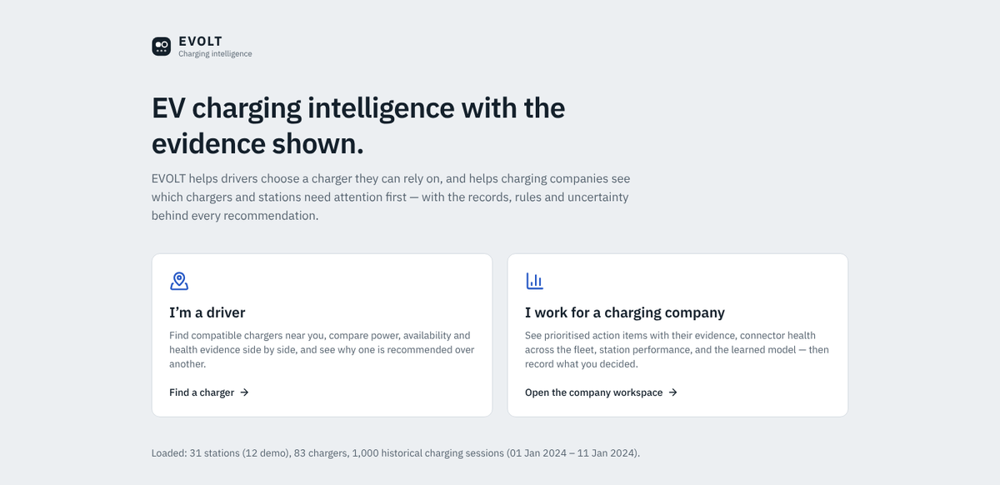
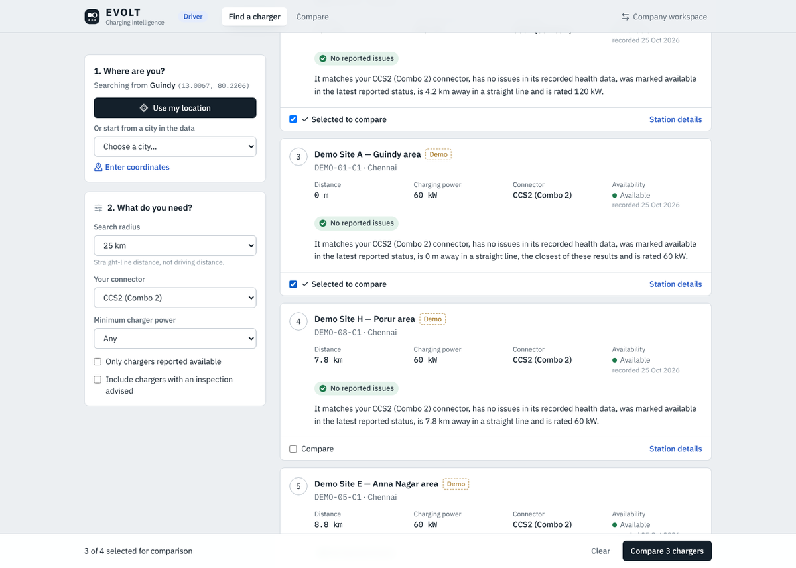
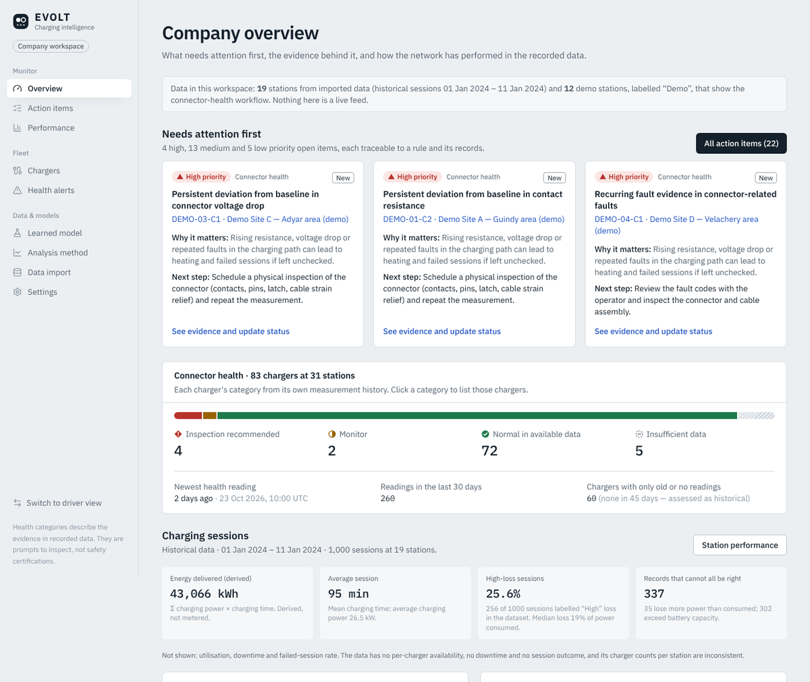
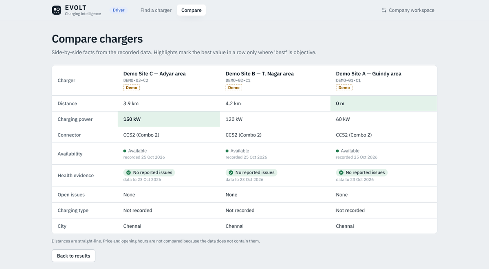
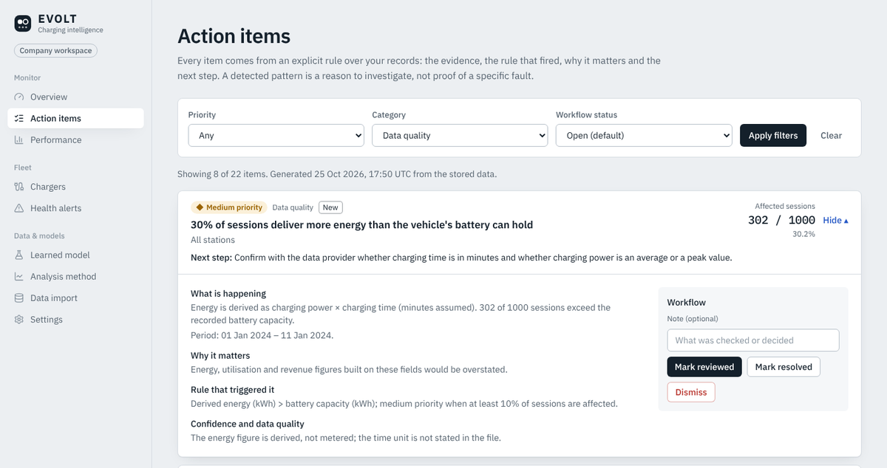
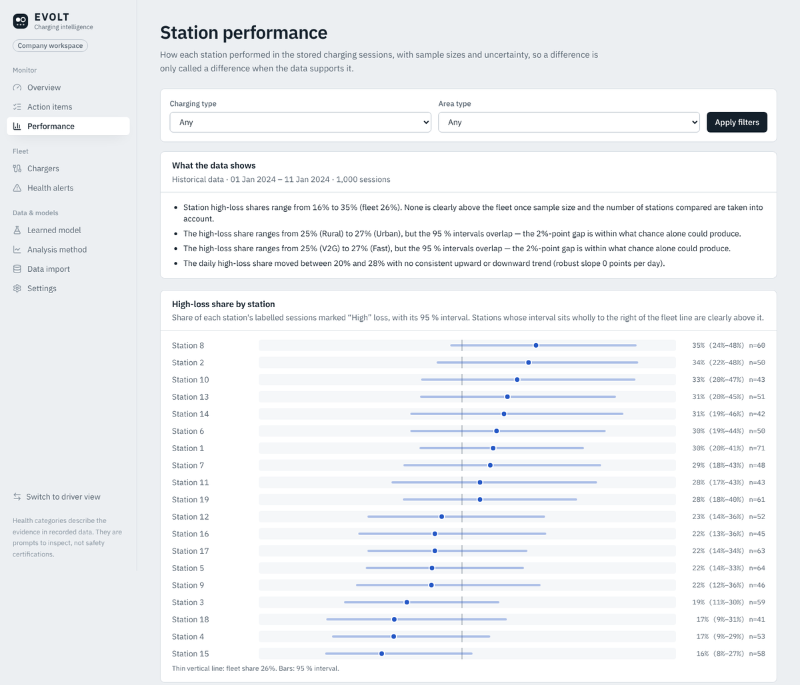
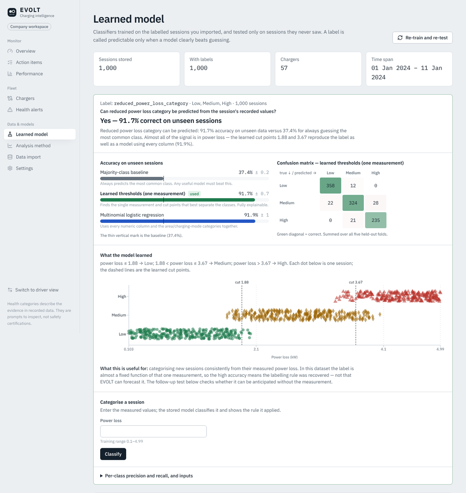
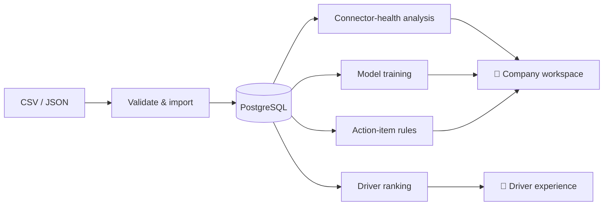

<div align="center">


# EVOLT

**EV charging intelligence — with the evidence shown.**

Drivers find a charger they can rely on. Charging companies see which chargers need attention
first, and why.


[Quick start](#-quick-start) · [For judges](#-a-2-minute-tour-for-judges) · [Features](#-what-it-does) · [How it works](#-how-it-works) · [Documentation](#-documentation)



</div>

---

## 🔍 The problem

Public EV chargers are often out of service or underperforming, and drivers usually find out only on arrival. Operators
collect plenty of data but still struggle to decide **which** charger to fix first, and to justify
that decision.

## 💡 The solution

EVOLT turns charging data into two focused experiences built on one database:

| 🚗 **Driver** | 🏢 **Charging company** |
|---|---|
| Find compatible chargers nearby, ranked so the ones with healthy evidence come first, and see them on a map with the **best match starred** | See prioritised **action items**, each with its evidence, the rule that fired, why it matters and the next step |
| Compare up to four chargers side by side; click any map pin to see the chargers at that spot | A **fleet map** coloured by connector health; track station performance and export the station table |
| Read a plain-English reason for every recommendation | Record decisions (reviewed / resolved / dismissed); they are stored in the database |

> **Every number is computed from stored records.** Nothing is hard-coded or shown as live
> telemetry, and an anomaly is always a reason to investigate, never proof of a fault.

<table>
<tr>
<td width="50%"></td>
<td width="50%"></td>
</tr>
<tr>
<td align="center"><sub><b>Driver</b> — ranked chargers, each with its reason</sub></td>
<td align="center"><sub><b>Company</b> — what needs attention first</sub></td>
</tr>
</table>

---

## 🚀 Quick start

**Requirement:** [Node.js 20.9+](https://nodejs.org) (LTS). Nothing else — no PostgreSQL install,
no API keys.

| Windows | macOS / Linux |
|---|---|
| Double-click **`run-evolt.bat`** | `./run-evolt.sh` |

The browser opens at **http://127.0.0.1:3000**. Pick **I'm a driver** or **I work for a charging
company**; each view links to the other.

<details>
<summary><b>What happens on first run?</b></summary>

<br/>

1. Installs dependencies (internet needed once, a few minutes).
2. Creates `.env.local` and starts a private PostgreSQL 17 instance in `.evolt/` (no installation).
3. Applies the database migrations.
4. Loads 12 labelled **demo** stations.
5. Imports the supplied session dataset through the normal import pipeline and trains the models.
6. Builds and starts the app.

Later starts take seconds and keep your data. Launcher options: `--rebuild`, `--no-seed`,
`--no-dataset`, `--no-open`, `--port 3001`.

</details>

<details>
<summary><b>Manual setup with your own PostgreSQL</b></summary>

<br/>

```bash
npm install
cp .env.example .env.local      # Windows: copy .env.example .env.local — then set DATABASE_URL
npm run db:migrate
npm run db:seed                 # optional: demo stations
npm run db:seed:dataset         # the supplied session dataset + model training
npm run build && npm start      # or: npm run dev
```

| Variable | Purpose |
|---|---|
| `DATABASE_URL` | PostgreSQL connection string (required) |
| `EVOLT_EDIT_MODE` | `open` for local and demo use; `token` for any public deployment |
| `EVOLT_ADMIN_TOKEN` | Required in token mode (16+ characters) |

Deployment to Vercel and a managed PostgreSQL database → [docs/deployment.md](docs/deployment.md).

</details>

---

## 🎯 A 2-minute tour for judges

| # | Go to | What to notice |
|---|---|---|
| 1 | **I'm a driver** → *start from a city* → **Chennai** | The map stars the best match; click any pin to see that station's chargers. Each result card gives a reason built only from facts in the record |
| 2 | Set **Your connector**, tick **Compare** on two results | Hard filters apply instantly; the side-by-side table highlights only objective bests |
| 3 | **Company workspace** → **Overview** → **Fleet map** | Opens with *Needs attention first*; the map shows where, coloured by health |
| 4 | **Action items** → open any item | Evidence, triggering rule, why it matters, next step; mark it reviewed and it persists |
| 5 | **Performance** | Station table with uncertainty intervals and CSV export; the takeaways say when a difference is just noise |
| 6 | **Learned model** → type `4.2` → **Classify** | A live prediction from the stored model, with its rule and tested accuracy |

---

## ✨ What it does

<details>
<summary><b>🚗 Driver experience</b> — find, compare, decide</summary>

<br/>

- **Location, three ways:** browser location (with permission), a city in the data, or typed
  coordinates. A denied permission or invalid input gets a clear message, never a guessed location.
- **Hard requirements vs preferences:**
  - *Must meet:* within radius, not offline, your connector, minimum power, optionally
    *available only*.
  - *Ranked by:* health evidence → availability → distance → power.
- **Honest wording:**
  - *Availability unknown* is never shown as available.
  - Status times are shown when they were recorded.
  - Distances are straight-line.
- **Map:** your location and search radius. The best match is starred, other matches are numbered by rank, and non-matching stations are faint. Click a pin to see a popup of every charger at that station, or click empty map to search from that point. Each result card has *Show on map*.
- **Compare** up to four chargers, and open a **station page** with chargers, a mini map of nearby stations, a coordinate copy
  button and its session history. No turn-by-turn directions are claimed.
- **Empty results** offer *search a larger radius* or *remove optional filters*, and say what was
  excluded and why.



</details>

<details>
<summary><b>🏢 Company workspace</b> — act on evidence</summary>

<br/>

| Page | Answers |
|---|---|
| **Overview** | What needs attention first · where it is (map) · fleet connector health · session KPIs with definitions · trends with computed takeaways |
| **Fleet map** | Every located station coloured by its most concerning charger, with health filters, a needs-attention list, and popups showing chargers, alerts and open items |
| **Action items** | What is happening · why it matters · what to do next · which rule fired · priority · confidence |
| **Performance** | How each station performed, with intervals; filter, sort, export CSV |
| **Chargers / Health alerts** | Per-charger evidence charts; acknowledge, resolve or dismiss alerts |
| **Learned model** | What the model can and cannot predict, plus a live classifier |
| **Data import** | Drag-and-drop CSV/JSON with auto-detection, column mapping, validation and data-quality findings |

**Priority** follows explicit rules:

- **High:** a connector-health analysis recommends inspection.
- **Medium:** a statistically clear station-level excess, or significant data inconsistencies.
- **Low:** data gaps, or a pattern that is no longer detected.

*“Marked resolved” records a decision; it never claims a charger was repaired.*





</details>

<details>
<summary><b>📊 What the dataset really shows</b> — findings, not decoration</summary>

<br/>

The supplied file holds **1,000 sessions** from **19 stations** (1–11 Jan 2024). EVOLT reports
what it supports, and also what it does not:

| Finding | What EVOLT does |
|---|---|
| Every station appears as urban, suburban **and** rural | No station can be located; these stations are listed separately for drivers |
| No availability, downtime or outcome fields | Utilisation, downtime and failure rate are **not shown**, and the app says why |
| 35 sessions lose more power than they consume | Raised as data-quality action items |
| 30 % of sessions deliver more energy than the battery holds | Medium-priority item: check the units with the data provider |
| “Fast” and other charging types deliver the same power | Low-priority item: the labels look wrong |
| Station loss rates range from 16 % to 35 % | None is outside chance once 19 comparisons are accounted for, and the app says so |

All figures were checked independently with pandas → [docs/analytics.md](docs/analytics.md).

</details>

<details>
<summary><b>🧠 Machine learning</b> — tested on unseen data, honest verdicts</summary>

<br/>

Stratified 5-fold cross-validation. Each label is tested against a guessing baseline, an
explainable threshold model and logistic regression. A label counts as predictable only if a
model clearly beats guessing.

| Question | Result | Guessing | Verdict |
|---|---|---|---|
| Power-loss category | **91.7 %** | 37.4 % | ✅ Predictable — rule: ≤ 1.88 kW Low · ≤ 3.67 kW Medium · else High |
| …without the power-loss reading | 37.0 % | 37.4 % | ❌ Loss must be measured |
| Voltage-stability category | 41.5 % | 40.4 % | ❌ Unrelated to every column — no prediction offered |

The 91.7 % recovers the dataset's labelling rule: it is useful for consistent categorisation, not
for forecasting. Predictions are served from the stored, evaluated model, and inputs outside the
training range are flagged. Details → [docs/machine-learning.md](docs/machine-learning.md).



</details>

---

## ⚙️ How it works



**Stack:** Next.js 16 · React 19 · TypeScript · Tailwind CSS 4 · PostgreSQL + Drizzle · Zod ·
Recharts · Vitest · Playwright.

**Maps without a map provider:** EVOLT draws its own map (Web Mercator, SVG) over a 268 KB
background file bundled with the app, built from public-domain Natural Earth data with India's
official boundaries. There are no tiles, API keys or network calls, and distances use the
Haversine formula on stored coordinates.

<details>
<summary><b>Project structure</b></summary>

<br/>

```text
src/app/            Entry page · /driver · /company · /api route handlers
src/features/       recommendations · insights · sessions · anomaly-detection ·
                    connector-health · learning · data-ingestion  (pure, tested logic)
src/components/     UI: driver, insights, charts, primitives
database/           SQL migrations · demo seed · dataset loader
scripts/            One-click launcher · offline model training
tests/              unit · integration · e2e
docs/               Detailed documentation (below)
```

Full breakdown and design decisions → [docs/architecture.md](docs/architecture.md).

</details>

<details>
<summary><b>Quality and testing</b> — 145 automated tests</summary>

<br/>

| Suite | Count | Covers |
|---|---|---|
| Unit | 99 | Metrics against pandas/SciPy, map projection and scale, every action-item rule, ranking, training, import, security |
| Integration | 22 | Real API handlers + PostgreSQL: imports, reviews, CSV export, predictions, access control |
| End-to-end | 24 | Both user journeys in Chromium (desktop + mobile), maps and popups, regressions, wording checks |

```bash
npm run lint && npm run typecheck && npm run test:unit
```

What was and was not verified → [docs/testing.md](docs/testing.md).

</details>

---

## ⚖️ Scope and limitations

- **Unverified data.** The supplied dataset's origin is unverified and it is internally
  inconsistent, so its findings describe the file, not a real network.
- **Demo stations.** They are labelled *Demo* everywhere and are not real sites. One click removes them.
- **No live data.** There is no live availability, price or opening hours, so none is shown.
- **Mapped stations.** Only stations with recorded coordinates appear on maps; the 19 dataset stations have none and are listed separately.
- **No authentication.** The driver/company switch is a demo-mode view choice. Use token mode
  before exposing EVOLT publicly.
- **Not a safety certification.** Health categories summarise recorded evidence.

---

## 📚 Documentation

| Guide | Contents |
|---|---|
| [Architecture](docs/architecture.md) | System design, data flow, repository layout, security model |
| [Data & analytics](docs/analytics.md) | Dataset findings, metric definitions, action-item rules, ranking logic |
| [Machine learning](docs/machine-learning.md) | Pipeline, evaluation protocol, results and how to read them |
| [API reference](docs/api.md) | Every endpoint, with examples |
| [Data dictionary](docs/data-dictionary.md) | Import formats, fields, units, database tables |
| [Testing](docs/testing.md) | Test suites, last verified run, what is not verified |
| [Deployment](docs/deployment.md) | Vercel + managed PostgreSQL |
| [Hardware bench](docs/hardware.md) | Optional Arduino low-voltage demo |
| [Change report](docs/CHANGE_REPORT.md) | Bugs fixed, features changed, verification |

<div align="center">
<sub>Research prototype · No licence declared yet — all rights reserved by the author · See <a href="CONTRIBUTING.md">CONTRIBUTING.md</a></sub>
</div>
