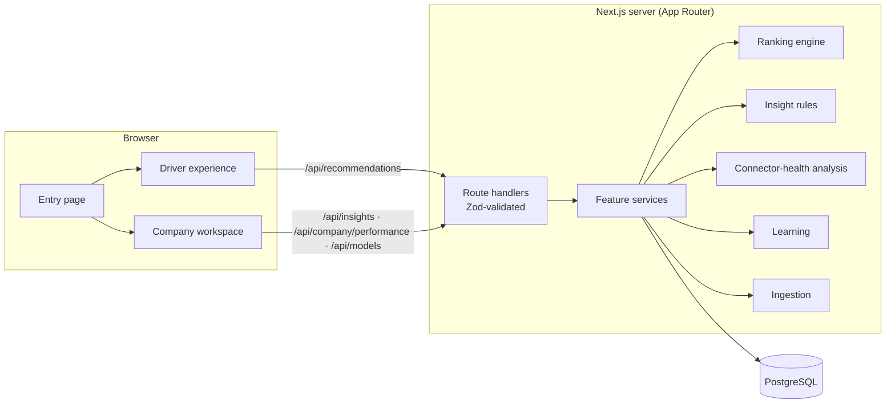
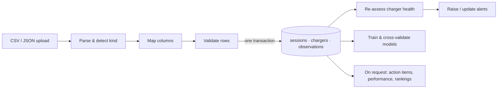

# Architecture

[← Back to README](../README.md)

EVOLT is a single Next.js application backed by one PostgreSQL database. All analysis, ranking
and model training run in-process; there is no external map, routing, geocoding or ML service.

## System overview



## Data flow



Every page and API response is computed from the stored records on request. Nothing is
hard-coded, cached from a mock, or presented as a live feed.

## Technology

| Layer | Choice |
|---|---|
| Framework | Next.js 16 (App Router, `cacheComponents`), React 19 |
| Language | TypeScript (strict) |
| Styling | Tailwind CSS 4, IBM Plex fonts (bundled locally) |
| Database | PostgreSQL 14+ via Drizzle ORM; versioned SQL migrations |
| Validation | Zod at every API boundary; strict query schemas |
| Charts | Recharts (single-series lines) and plain HTML/SVG interval charts |
| Parsing | Papa Parse |
| Tests | Vitest (unit, integration), Playwright (desktop + mobile) |
| Local run | `embedded-postgres` for a zero-install database |

## Repository layout

```text
src/
  app/
    page.tsx                  Entry: choose Driver or Company
    driver/                   Driver layout · finder · compare · station pages
    company/                  Company layout · overview · actions · performance · chargers ·
                              alerts · model · method · data · settings
    api/                      Route handlers ({ data } / { error } envelopes)
  features/
    recommendations/          Driver ranking engine (constraints, preferences, explanations)
    insights/                 Action-item rules · performance analytics · review workflow
    sessions/                 Session normalisation and metrics (pure, tested)
    anomaly-detection/        Baselines, persistence, Theil–Sen trends, fault recurrence
    connector-health/         Charger assessment, alerts and alert workflow
    learning/                 Training, cross-validation, prediction
    data-ingestion/           Parsing, detection, mapping, validation, transactional import
  components/                 UI building blocks (driver, insights, charts, ui primitives)
  lib/                        DB client, schema, security, HTTP helpers, validation
database/
  migrations/                 Forward-only SQL (0000–0003)
  seed/                       Demo stations · dataset loader
scripts/
  run-local.mjs               One-click launcher (embedded PostgreSQL)
  train-model.ts              Offline, reproducible training → models/session-models.json
tests/                        unit · integration · e2e
```

## Key design decisions

| Decision | Why |
|---|---|
| Pure functions for every calculation (`features/sessions`, `features/insights`, `features/recommendations`) | Unit-testable against independently computed numbers (pandas, SciPy) |
| Rules over opaque scores for action items | Every item can cite the rule, the threshold and the records behind it |
| Bonferroni-adjusted intervals when comparing stations | Testing 19 stations at 95 % would flag about one by chance |
| No map provider | Requirement; distance is Haversine on stored coordinates, and no directions are claimed |
| Demo records flagged in the database, labelled “Demo” in the UI | Lets the workflow be shown without passing generated data off as real |
| Workflow status separate from charger status | “Marked resolved” records a decision; it never claims a repair |

## Security model

- Writes (imports, workflow changes, retraining) go through `requireAdmin`. It refuses
  cross-site requests and, in `token` mode, requires `EVOLT_ADMIN_TOKEN` (Bearer header or a
  signed, httpOnly session cookie).
- Local installs default to `open` editing; any deployment should set `EVOLT_EDIT_MODE=token`.
- The driver/company switch is a demo-mode view choice, **not** authentication. There is one
  workspace and no per-company data separation.
- Uploads are parsed as data only, are size-limited (2 MiB by default) and are validated row by
  row. Security headers are set in `next.config.ts`.
