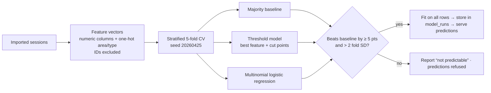

# Machine learning

[← Back to README](../README.md)

EVOLT trains a classifier for every label column in the imported sessions. It reports how well
each one does on sessions it never saw, and offers predictions only for labels that clearly beat
guessing. The code is pure TypeScript in `src/features/learning`, with no external service.

## Pipeline



1. **Inputs.** Numeric columns present in every labelled row (identifier columns excluded), plus
   one-hot area type and charging type.
2. **Models.**
   - A majority-class baseline.
   - An explainable threshold model: the single feature and cut points that best separate the
     classes, found exactly by dynamic programming.
   - Multinomial logistic regression: standardised inputs, L2 regularisation.
3. **Evaluation.** Stratified 5-fold cross-validation. Every fitted choice (feature, cut points,
   weights) is made inside the training folds only. Reported: accuracy ± fold standard
   deviation, macro-F1, the confusion matrix, and per-class precision and recall.
4. **Decision rule.** A label is *predictable* only if the best model beats the baseline by at
   least 5 points **and** by more than two fold standard deviations. The explainable model is
   preferred when it is within 1 point of the best.
5. **Follow-up test.** When a label is reproduced by a single measurement, the model is
   retrained without that measurement. This asks whether the label can be anticipated without
   measuring it.
6. **Artifacts.** Each run's full report and fitted parameters are stored in `model_runs` and
   reloaded for every prediction. `npm run model:train` reproduces the run offline and writes
   `models/session-models.json`.
7. **Inference.** `POST /api/models/predict` (and the *Categorise a session* form):
   - validates the inputs and rejects missing values;
   - warns when a value is outside the training range;
   - refuses labels that were not learnable;
   - returns the prediction, the rule applied and the model's cross-validated accuracy.

## Results on the supplied dataset

All results use 5-fold cross-validation and were cross-checked with scikit-learn.

| Question | Best model | Guessing baseline | Verdict |
|---|---|---|---|
| Power-loss category, from the recorded values | **91.7 %** — threshold: ≤ 1.88 kW Low · ≤ 3.67 kW Medium · else High | 37.4 % | Predictable |
| Power-loss category, **without** `power_loss` | 37.0 % | 37.4 % | Not predictable |
| Voltage-stability category | 41.5 % | 40.4 % | Not predictable |

### How to read these results

- **91.7 % recovers a labelling rule; it is not a forecast.** The category is almost a fixed
  function of `power_loss`. The model is useful for categorising new sessions consistently from
  their measured loss.
- **Loss must be measured.** Without the power-loss reading, no other column carries usable
  signal (≈ 37 % vs 37.4 %).
- **Voltage stability is unrelated to every recorded column.** EVOLT says so and offers no
  prediction.

Results describe this file only. It contains physically inconsistent records (see
[analytics](analytics.md)), so these accuracies are not evidence about real chargers.

## Connector degradation: what can and cannot be predicted

Reproduce with `npm run model:degradation` (writes `models/degradation-report.json`; a unit
test checks the committed file equals a fresh run). Code: `src/features/learning/degradation.ts`.

### The unified training dataset

`database/data/unified-evolt-arduino-training-dataset.csv` (1,000 rows, 36 columns, no missing
cells, no duplicate ids). The audit shows every Arduino-style column is **derived from the
session columns**:

| Column | Is exactly |
|---|---|
| `C1_V` | `voltage_level` |
| `C1_mA` | 340 × `current_flow` |
| `C1_Deg_pct` | clip(100 × `power_loss` ÷ `power_consumed`, 0, 100) — 35 rows clipped at 100 % because loss exceeds consumption |
| `C2_*`, `C3_*` | `C1_*` × fixed factors (0.998 / 1.002 voltage, 0.971 current, 0.98 / 1.02 degradation) |
| `Avg_Deg_pct` | mean of C1–C3 degradation |

So the "degradation" target is a formula of two input columns, not an independent label.

### Study design (leakage-aware)

- Target `Avg_Deg_pct`; regression metrics MAE, RMSE, R² (percentage points).
- **Device-aware:** 5-fold cross-validation grouped by station — a station's sessions are never
  in both training and test. **Time-aware:** train on the earliest 80 %, test on the latest 20 %.
- Baseline = median of the training rows; model = ridge regression on standardised features (λ = 1).
- Three feature sets, each answering one question. The C1–C3 columns are never used as
  features (they are copies of the target or of session columns).

| Features | Test split | Baseline MAE | Ridge MAE | Ridge RMSE | Ridge R² |
|---|---|---|---|---|---|
| Loss and consumption (the target's own inputs) | Held-out stations (5-fold grouped) | 17.08 | 0.07 | 0.11 | 1.000 |
| Loss and consumption (the target's own inputs) | Latest 20 % in time | 16.38 | 0.07 | 0.10 | 1.000 |
| All session measurements except power loss | Held-out stations (5-fold grouped) | 17.08 | 12.53 | 16.40 | 0.547 |
| All session measurements except power loss | Latest 20 % in time | 16.38 | 12.05 | 15.38 | 0.549 |
| …and without current or power (which sit in the target's denominator) | Held-out stations (5-fold grouped) | 17.08 | 18.29 | 24.46 | -0.007 |
| …and without current or power (which sit in the target's denominator) | Latest 20 % in time | 16.38 | 18.25 | 23.45 | -0.048 |

**Reading it:** with the target's own inputs the "model" is perfect because it is the
definition. Without power loss, R² ≈ 0.55 comes only from current and power, which sit in the
formula's denominator — arithmetic, not wear. Without those, nothing beats the baseline. **No
degradation predictor is deployed from this dataset**; doing so would present a formula as a
forecast.

### What is deployed: the bench model

The only measured degradation signal is the bench voltage (Arduino run 2: three connectors, each
swept repeatedly between near-healthy and open circuit). The connectors have different loads
(493 / 350 / 388 Ω) and different healthy levels V_ref (3.455 / 3.067 / 3.193 V), so a voltage
only means something relative to its own connector. Least squares on the 314 conducting readings
below 100 % gives

```
degradation % = 100.11 − 100.23 × (V ÷ V_ref)      (log's definition: 100 − 100 × V ÷ V_ref)
```

with V_ref measured per connector. Three models were compared on data they never saw:

| Model | Each sweep held out in turn (MAE) | Each connector held out (MAE) |
|---|---|---|
| One voltage line for all connectors | 2.28 points | C1 4.52 · C2 3.53 · C3 1.05 |
| A separate voltage line per connector | 0.09 points | — (needs that connector's full history) |
| **Relative voltage V ÷ V_ref (deployed)** | **0.09 points** | **C1 0.09 · C2 0.12 · C3 0.09** |

For a held-out connector the relative model gets only that connector's **first sweep**
(commissioning) to set its V_ref — 3.455 / 3.064 / 3.195 V, within 3 mV of the full-run values —
and is tested on its remaining sweeps. That is the improvement over a single voltage line: one
model that serves every connector, and a new one after a single commissioning sweep. Open-circuit
readings (0 V = 100 % by definition) are excluded from fitting and testing.

The model is saved in `models/degradation-report.json`, re-fitted from the database on every
bench-page load (the page says whether they match), and served by
`GET /api/bench/estimate?voltage=…&connector=C1|C2|C3` or `…&referenceV=…` for a new connector.

**Input scale:** experimental-circuit volts only (≤ 5 V). Real-charger voltages are refused with
an error — the model describes the bench's index, not real connector wear, and scaling
electrical readings does not scale degradation. The sweeps are a controlled stress pattern, so
they give no rate of wear over time. The real-world consequence of a bench state is shown
separately by the scaling (see [scaling.md](scaling.md)).
