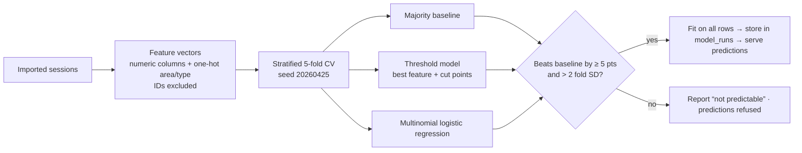

# Machine learning

[← Back to README](../README.md)

EVOLT trains a classifier for every label column in the imported sessions. It reports how well
each one does on sessions it never saw, and offers predictions only for labels that clearly beat
guessing. The code is pure TypeScript in `src/features/learning`, with no external service.

## Pipeline

1. **Inputs.** Numeric columns present in every labelled row (identifier columns excluded), plus
   one-hot area type and charging type.
2. **Models.**
   - A majority-class baseline.
   - An explainable threshold model: the single feature and cut points that best separate the
     classes, found exactly by dynamic programming.
   - Multinomial logistic regression: standardised inputs, L2 regularisation.
3. **Evaluation.** Stratified 5-fold cross-validation. Every fitted choice (feature, cut points,
   weights) is made inside the training folds only. Reported: accuracy ± fold standard
   deviation, macro-F1, the confusion matrix, and per-class precision and recall.
4. **Decision rule.** A label is *predictable* only if the best model beats the baseline by at
   least 5 points **and** by more than two fold standard deviations. The explainable model is
   preferred when it is within 1 point of the best.
5. **Follow-up test.** When a label is reproduced by a single measurement, the model is
   retrained without that measurement. This asks whether the label can be anticipated without
   measuring it.
6. **Artifacts.** Each run's full report and fitted parameters are stored in `model_runs` and
   reloaded for every prediction. `npm run model:train` reproduces the run offline and writes
   `models/session-models.json`.
7. **Inference.** `POST /api/models/predict` (and the *Categorise a session* form):
   - validates the inputs and rejects missing values;
   - warns when a value is outside the training range;
   - refuses labels that were not learnable;
   - returns the prediction, the rule applied and the model's cross-validated accuracy.

## Results on the supplied dataset

All results use 5-fold cross-validation and were cross-checked with scikit-learn.

| Question | Best model | Guessing baseline | Verdict |
|---|---|---|---|
| Power-loss category, from the recorded values | **91.7 %** — threshold: ≤ 1.88 kW Low · ≤ 3.67 kW Medium · else High | 37.4 % | Predictable |
| Power-loss category, **without** `power_loss` | 37.0 % | 37.4 % | Not predictable |
| Voltage-stability category | 41.5 % | 40.4 % | Not predictable |

### How to read these results

- **91.7 % recovers a labelling rule; it is not a forecast.** The category is almost a fixed
  function of `power_loss`. The model is useful for categorising new sessions consistently from
  their measured loss.
- **Loss must be measured.** Without the power-loss reading, no other column carries usable
  signal (≈ 37 % vs 37.4 %).
- **Voltage stability is unrelated to every recorded column.** EVOLT says so and offers no
  prediction.

Results describe this file only. It contains physically inconsistent records (see
[analytics](analytics.md)), so these accuracies are not evidence about real chargers.
